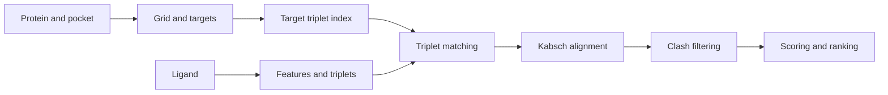

# How the docking algorithm works

## Overview

The program performs rigid protein–ligand docking in a known binding pocket. It searches for the
ligand's position and orientation without changing its internal conformation or the protein.
It does not explore ligand torsions or locate an unknown pocket.

Compatible triangles of chemical features provide candidate correspondences. Kabsch alignment
turns each correspondence into a pose of the whole ligand, followed by clash filtering and scoring.

Protein and pocket coordinates must share a frame. The input ligand need not start in the pocket:
alignment rotates and translates it onto protein targets. A reference used to evaluate docking
RMSD must instead be in the protein frame.

## Interaction areas

`chem-interactions` identifies physical interaction areas: hydrophobic, hydrogen-bond, halogen-bond,
ionic, aromatic and metal-related features. Each area retains its defining atoms and centroid.

Geometric matching uses a simpler `MatchingArea`: a centroid, chemical key, interaction radius and
source-area identity. Ligand keys describe their own chemistry; protein keys describe compatible
ligand chemistry. For example, a protein hydrogen-bond acceptor exposes a ligand-donor key.

One physical protein area can expose several matching entries, such as aromatic and cationic keys.
They retain the same source identity and cannot serve as independent anchors in one triplet.
These keys propose contacts; WeightedInteraction evaluates physical interaction geometry.

## Protein and ligand preparation

RDKit loads the protein and pocket PDB files and ligand MOL2 records. Protein and ligand molecules
are sanitized before extracting physical and matching areas.

Protein preparation builds a voxel grid around the pocket. Occupied voxels approximate the protein's
van der Waals volume; free voxels carry chemical-compatibility masks. Free space and chemical
compatibility are separate properties.

At most one target is chosen per protein matching area, among free voxel centres within its
interaction radius and the pocket region. Selection favours clearance: the minimum, over all protein
atoms, of target-to-atom distance minus the atom's van der Waals radius. Areas without a valid
position produce no target. Optional clearance pruning removes selected targets before indexing,
without changing the protein or clash grid. It is disabled by default, which differs from a zero
threshold.

Ligand preparation generates matching-area triplets while preserving the input conformer. Its
geometric diameter is measured between physical area centroids, not atoms. Protein target triplets
are indexed for repeated queries; shared-index applications reuse this preparation across ligands.
See [protein_preparation.cpp](../src/protein_preparation.cpp) and
[ligand_preparation.cpp](../src/ligand_preparation.cpp).

## Triplet matching

Triplets use three distinct physical source areas. All sides must satisfy the construction cutoff;
very short edges and triangles below an absolute area threshold are rejected.

A triplet signature combines chemical keys with distance bins. Canonicalization examines all six
vertex permutations and chooses the smallest signature. All tied ligand orderings are retained;
the protein index stores a canonical target ordering.

Lookup requires compatible keys and searches the query bin and its neighbours for each side. This
is an approximate geometric test: matched triangles need not be congruent, and no additional filter checks
their real edge-length differences.

Each retrieved target record and retained ligand ordering creates an alignment attempt, so match
and transformation counts can differ. Repeated or equivalent poses are retained without geometric
deduplication. See [triplet_generation.cpp](../src/triplet_generation.cpp).

## Rigid alignment and clash filtering

Kabsch minimizes the squared distances between three ordered point pairs using a proper rotation
and translation, excluding reflections. SVD is the default; quaternion/Jacobi is also available on
CPU and CUDA. Both fit in double precision. The transform places the whole ligand, but no maximum
fit-residual threshold is applied: approximate triangle matches can leave imperfect point overlap.

The clash filter measures the fraction of transformed ligand atom centres in occupied protein
voxels. A pose survives if this fraction is at most the threshold, 0.05 by default. All retained
atoms, including explicit hydrogens, enter the denominator. Atoms outside the grid count as free.
This is a voxel approximation, not continuous overlap between atomic spheres. Unweighted chemical
support is diagnostic and does not determine survival.

## Scoring and ranking

Scoring assigns values to poses; ranking orders a candidate pool. Different protocols may score
different pools, so their final rankings are not automatically comparable.

### Fast

Fast sums chemical weights for ligand matching-area centroids in free voxels with the required
compatibility bit. Higher is better. It counts matching entries independently, without ligand-size
normalization or full interaction-geometry checks.

### WeightedInteraction

WeightedInteraction recognizes contacts using physical areas and their defining atoms. It sums the
best applicable interaction weight for each ligand area:

\[
W=\sum_{a\in A_L}\max\bigl(\{0\}\cup
\{w_{\tau(c)}:c\text{ is a contact involving area }a\}\bigr).
\]

Here, $A_L$ contains physical ligand areas and $w_{\tau(c)}$ is the contact-type weight.
Higher is better. Multiple contacts on one area do not multiply its reward; contact counts and
coverage are recorded separately. The default receptor uses pocket protein areas;
`gpu_docking` can instead use full-protein areas. See
[interaction_scoring.cpp](../src/interaction_scoring.cpp).

### Vinardo-like

Vinardo-like sums supported heavy-atom pair contributions within a strict 8 Å centre-distance cutoff.
Distances between scoring surfaces control Gaussian attraction, quadratic overlap repulsion, and
hydrophobic and hydrogen-bond attraction, using approximate RDKit atom typing. Lower is better.

It evaluates the full protein's supported heavy atoms, independently of the WeightedInteraction
region. Unsupported receptor atoms are skipped and counted; unsupported ligand elements cause an
error. No intramolecular or torsional term is included. It is not a validated affinity in kcal/mol.

Repulsion is adjustable as `V_alpha = V + (alpha - 1) * V_repulsion`. Alpha defaults to 1;
rep50 uses 0.5 without changing the other terms. See [vinardo_scoring.cpp](../src/vinardo_scoring.cpp).

### Hybrid

Hybrid combines WeightedInteraction and sign-reversed adjusted Vinardo:

\[
H=\lambda z(W)+(1-\lambda)z(-V_\alpha).
\]

Higher is better. Each z-score uses the mean and population standard deviation of the full
rescoring pool for that ligand, after any Fast prefilter and before Top-K selection.
Constant components contribute zero. Scores normalized on different pools are not directly
comparable. Lambda defaults to 0.3 and is configurable in [0, 1]; alpha is independent, so Hybrid
does not imply rep50. See [pose_score_ranking.cpp](../src/pose_score_ranking.cpp).

## CPU and CUDA implementations

Both prepare molecular chemistry on the host. CUDA performs lookup, alignment, clash filtering and
Fast scoring on the device, reusing the protein grid, targets and index across ligands.
`gpu_docking` supports CPU or CUDA rescoring and ranking.

| Application | Search and scoring protocol |
| --- | --- |
| `geometric_docking` | CPU search; Fast on all survivors, then WeightedInteraction on the Fast top-500 by default. No Vinardo or Hybrid CLI. |
| `gpu_docking` | CUDA search; Fast, WeightedInteraction, Vinardo-like or Hybrid ranking. Rescoring uses all survivors by default, with an optional Fast prefilter. |
| `multi_ligand_screen` | CPU screening; exports the maximum Fast score per ligand, without full rescored ranking. |
| `multi_ligand_screen_gpu` | CUDA Fast screening; optional CPU WeightedInteraction/Vinardo-like joint export, without rescored ranking or Hybrid. |

The single-complex CPU pipeline builds its protein index using the ligand's area-centroid diameter.
Both screeners and `gpu_docking` use a fixed shared cutoff, 24 Å by default, without per-ligand
fallback. This limits indexed triplet sides, not allowed ligand size. Lookup does not reapply the
ligand diameter, so these policies can generate different pools. Prefilters and tie-breaking also
differ between applications; equal scoring formulas do not make their protocols interchangeable.
See the [usage guide](uso.md) for application options.

## RMSD and limitations

RMSD measures coordinate differences under fixed atom correspondence, in angstroms.
No superposition onto the reference or symmetry correction is performed. To measure docking error,
the reference must represent the same ligand in the protein frame. RMSD never selects or ranks poses.

CPU pose-generation diagnostics compare all retained atoms with the input conformer, by atom index.
This measures crystal-reference error only when that input is the crystal pose in the protein frame.
An arbitrarily placed input is valid for search, but its automatic CPU RMSD is not that error.

With a separate optional reference, `gpu_docking` evaluates heavy-atom RMSD for exported poses
after ranking. It requires matching atom order and molecular graph, including explicit hydrogens,
but excludes hydrogens from RMSD. It does not infer correspondence. These values need not match CPU
diagnostics. See [gpu_docking_output.cpp](../src/gpu_docking_output.cpp).

The lowest available RMSD measures coverage of the candidate pool; Top-K RMSD also reflects ranking.
The search is not exhaustive: rigid conformations, feature typing, target sampling, cutoff and
voxel discretization limit coverage. Free voxels establish neither solvent accessibility nor a
continuous entry path into the pocket.
